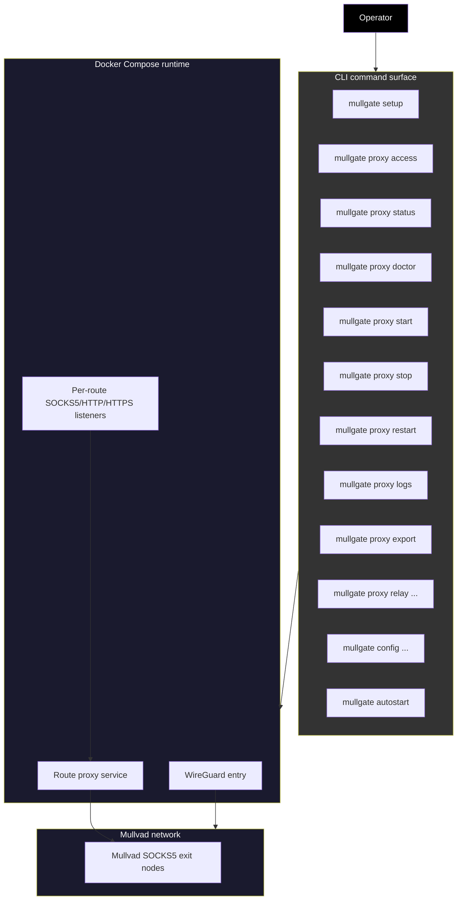

<p align="center">
  
</p>


<p align="center">
  <a href="https://github.com/Microck/mullgate/releases"></a>
  <a href="https://www.npmjs.com/package/mullgate"></a>
  <a href="https://github.com/Microck/mullgate/actions/workflows/ci.yml"></a>
  <a href="LICENSE"></a>
</p>

---

`mullgate` turns one Mullvad subscription into many authenticated SOCKS5, HTTP, and HTTPS proxies for selected apps. It is built for operators who want route-specific exits, app-level routing, and clear operator surfaces without sending the whole machine through a VPN.

The main setup path is `mullgate setup`. On a real terminal it opens a guided flow that collects your Mullvad account number, proxy credentials, route aliases, bind posture, and optional HTTPS settings, then persists canonical config plus the derived runtime artifacts needed for `proxy start`, `proxy status`, and `proxy doctor`. If you prefer automation, the same surface also supports a fully non-interactive env-driven setup path.

[documentation](https://mullgate.micr.dev) | [npm](https://www.npmjs.com/package/mullgate) | [github](https://github.com/Microck/mullgate)

<p align="center">
  
</p>


## Start here

`mullgate` currently requires Node.js 22+.

Install from npm for the normal path, or use a GitHub release standalone binary/archive when you want a pinned platform artifact.

```bash
npm install -g mullgate
mullgate --help
mullgate setup
```

For a repeatable server setup, start from [`.env.example`](.env.example) and run:

```bash
mullgate setup --non-interactive
mullgate proxy start --dry-run
mullgate proxy start
mullgate proxy status
mullgate proxy doctor
```

Use Linux for the full live runtime. macOS and Windows support install, config inspection, status, and doctor surfaces, but the Docker runtime depends on Linux host-networking behavior.

## Why

If you want Mullvad-backed proxy access without replacing your computer's normal network path, `mullgate` gives you a practical path.

- expose authenticated SOCKS5, HTTP, and HTTPS proxy endpoints from your own Mullvad subscription
- route only the traffic you choose instead of tunneling the whole machine
- scale many routed exits from one shared Mullvad WireGuard device instead of spending one device slot per route
- keep setup, proxy operations, relay selection, and diagnostics in one CLI
- stay in control of the host and credentials instead of depending on a hosted relay service

## How Mullgate differs from Mullvad's SOCKS5 proxy

Mullvad's SOCKS5 proxy is a SOCKS5 endpoint inside the Mullvad VPN tunnel. You connect to Mullvad first, then manually point an app or browser at that proxy.

Mullgate is a local operator layer built around a Mullvad subscription. It provisions named exits, exposes authenticated SOCKS5, HTTP, and HTTPS proxy entrypoints on your machine, and gives you one CLI surface for setup, exposure control, runtime checks, and failure diagnostics.

The goal is not "replace Mullvad's proxy page with another set of manual steps." The goal is to give self-hosters a managed proxy gateway that uses Mullvad exits without forcing the whole machine through the VPN.

Mullgate solves Mullvad's device cap by provisioning one shared WireGuard entry device and fanning out to exact Mullvad SOCKS5 exits per route.

For operators with the Tailscale Mullvad add-on, Mullgate also supports an opt-in `tailscale-exit` source. This replaces the Mullvad WireGuard entry container with one Tailscale sidecar pinned to a Mullvad exit, then connects route proxies directly to resolved Mullvad internal SOCKS IPs such as `10.124.x.x:1080`. See [Tailscale Exit Source](docs/mullgate-docs/content/docs/guides/tailscale-exit-source.mdx) for setup details and the live feasibility verifier.

## Architecture



## Quickstart

### 1. Install

```bash
npm install -g mullgate
```

### 2. Setup

```bash
mullgate setup
```

This walks you through:
- Mullvad account number
- Mullvad proxy credentials (username/password from the Mullvad website)
- Route aliases (friendly names for your proxy exits)
- Bind posture (localhost, private network, or public)
- Optional HTTPS certificate setup

### 3. Start

```bash
mullgate proxy start
```

### 4. Check

```bash
mullgate proxy status
mullgate proxy doctor
```

### 5. Export proxy lists

```bash
mullgate proxy export --guided
```

## Commands

| Command | Description |
|---------|-------------|
| `mullgate setup` | Guided or non-interactive setup |
| `mullgate proxy start` | Start the proxy runtime |
| `mullgate proxy stop` | Stop the proxy runtime |
| `mullgate proxy restart` | Restart the proxy runtime |
| `mullgate proxy status` | Show runtime status |
| `mullgate proxy doctor` | Diagnose runtime issues |
| `mullgate proxy logs` | Show runtime logs |
| `mullgate proxy access` | Show access credentials |
| `mullgate proxy export` | Export proxy lists |
| `mullgate proxy relay list` | List available relays |
| `mullgate proxy relay probe` | Probe relay latency |
| `mullgate proxy relay verify` | Verify route exits |
| `mullgate proxy relay recommend` | Get relay recommendations |
| `mullgate config path` | Show config file path |
| `mullgate config show` | Show current config |
| `mullgate config edit` | Edit config in editor |
| `mullgate autostart` | Manage systemd autostart |
| `mullgate version` | Show version |
| `mullgate completions` | Generate shell completions |

## Documentation

Full documentation is at [mullgate.micr.dev](https://mullgate.micr.dev).

## License

MIT
